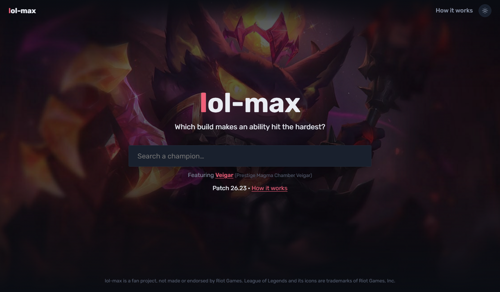
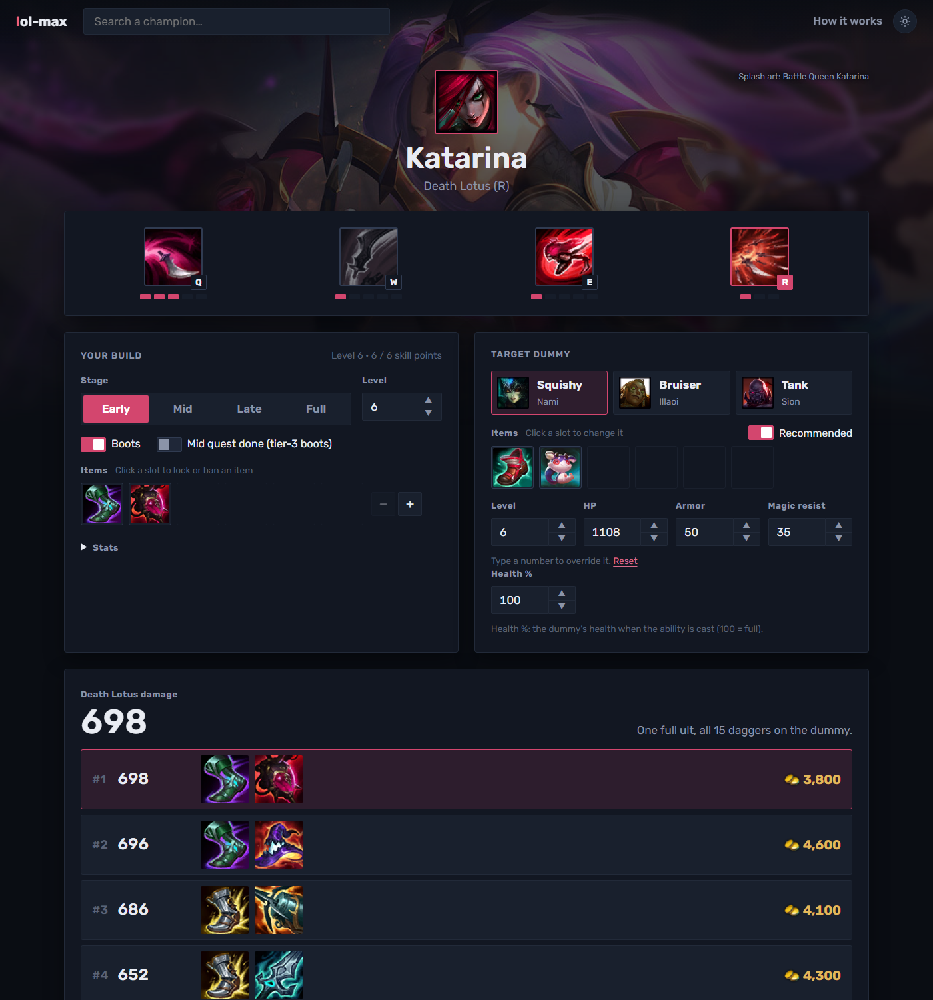
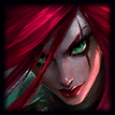
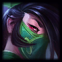
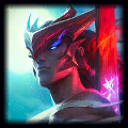
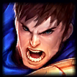
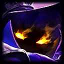
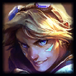

<div align="center">


# lol-max

**Which build makes an ability hit the hardest?**

Pick a champion and an ability. lol-max simulates every hit of the cast against a target dummy and shows the top 5 builds.

[**▶ Try it at lol.ericzhong.ca**](https://lol.ericzhong.ca)




</div>

---

## What it does

> Does AD, AP or on-hit Katarina get the biggest **Death Lotus**?

It's for fun ("dopamine maxing"), but the math has to be right. Every hit, on-hit effect, item passive and armor or magic resist calculation is simulated in order, and each formula has a unit test.

<div align="center">

</div>

### Features

| | |
|---|---|
| 🏆 **Top 5 builds** | Every legal item combination for Early and Mid. A beam search for Late and Full, tested against the full search. |
| 🎯 **A real target dummy** | Squishy (Nami), bruiser (Illaoi) or tank (Sion), with recommended items, a level, and a health % to start from. |
| 🧮 **Damage breakdowns** | By source (base, AP, AD, on-hit, each item), each item's marginal damage, by damage type, and ability vs. items. |
| 💥 **Crits done right** | "No crit / crit" for abilities that can crit. Yone's passive, Infinity Edge, and Sundered Sky's guaranteed crit on Garen's Q. |
| 🔒 **Your rules** | Lock or ban items, turn boots on or off, set minimum stats, or rank builds by a stat instead of damage. |
| ⚡ **Runs in your browser** | No server and no accounts. The search runs in a Web Worker, so the page never freezes. |

### Champions

| Champion | Modelled abilities |
|---|---|
|  **Katarina** | Q · E · R |
|  **Akali** | Q · E · R |
|  **Yone** | Q · W · R |
|  **Garen** | Q · E · R |
|  **Lux** | Q · E · R |
|  **Caitlyn** | Q · E · R |
|  **Veigar** | Q · W · R |
|  **Ezreal** | Q · W · E · R |

Every other champion has a page too, with their abilities marked "coming soon".

## How the numbers stay correct

- **Sourced data.** Ability numbers come from the [League of Legends Wiki](https://wiki.leagueoflegends.com). Item stats come from a saved snapshot of Riot's Data Dragon. Every game number lives in a data file with its source link and patch.
- **Hand-coded item passives.** Each passive that changes damage has its own file in [`src/items/`](src/items) and its own test.
- **Practice Tool checks.** Measurements from the in-game Practice Tool are recorded in [`tests/`](tests) and compared with the calculator.
- **Clear rules.** The dummy never dies (overkill still counts), item actives don't count, and effects count only inside a fixed window. All the rules are on the site's [How it works](https://lol.ericzhong.ca/about) page.

## Run it yourself

You need [Node.js](https://nodejs.org) (v24 works).

```bash
npm install     # once, after cloning
npm run dev     # start the site locally
npm test        # run every test
npm run build   # type-check and build into dist/
```

More commands (patch day, updating items and icons, wiki checks) are listed in [`NOTES.md`](NOTES.md#how-to-run).

## Project layout

```
src/
  data/         game numbers, each with a source link and patch
  items/        one file per hand-coded item passive
  simulation/   the hit-by-hit simulation and each champion's abilities
  optimizer/    item pool, beam search, top 5, explanations (runs in a Web Worker)
  ui/           pages, search, build cards and breakdowns
scripts/        download item data, icons and splash art; patch-day tools
tests/          unit tests and the Practice Tool validation
```

Decisions and their reasons are in [`NOTES.md`](NOTES.md), and the plan is in [`PLAN.md`](PLAN.md).

---

<div align="center">
<sub>Built by Eric Zhong. lol-max is a fan project, not made or endorsed by Riot Games. League of Legends and its icons are trademarks of Riot Games, Inc.</sub>
</div>
